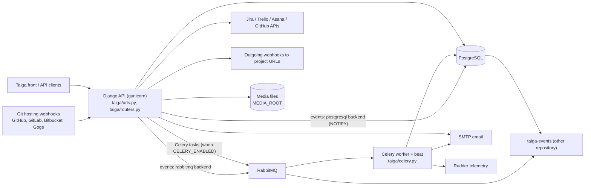

# Architecture

taiga-back is a Django 3.2 project that serves the Taiga REST API. One codebase and one Docker image run two processes: the API (gunicorn) and the async worker (Celery worker with beat).

Outgoing webhooks, imports and exports go through Celery when it is enabled (`if settings.CELERY_ENABLED: task.delay(...)`), otherwise they run in the API process. Bulk notification emails are sent by the Celery beat task `send-bulk-emails`.

## API web app

- Folder: `taiga/` (`taiga/urls.py`, `taiga/routers.py`, `taiga/wsgi.py`).
- What it does: serves `/api/v1/` (86 `router.register` calls in `taiga/routers.py`), the Django admin on `/admin/`, and the front sitemap on `/front/sitemap*.xml` when `FRONT_SITEMAP_ENABLED`.
- Tech: Django 3.2, gunicorn in Docker (`docker/entrypoint.sh`: `migrate`, `loaddata initial_project_templates`, then gunicorn on port 8000 with 3 workers).
- Depends on: PostgreSQL, the domain apps, `taiga/base`.

## Base framework

- Folder: `taiga/base`.
- What it does: Taiga's own REST layer, close to Django REST framework but not the same package (`taiga/base/api`: viewsets, serializers, permissions, routers, throttling, filters in `taiga/base/filters`, exceptions in `taiga/base/exceptions.py`). It also holds DB helpers, mail helpers and shared management commands.
- Rule: new endpoints use `taiga.base.api`, not `rest_framework`.

## Domain apps

Each app has `models.py`, `api.py` (viewsets), `serializers.py`, `validators.py`, `permissions.py`, `services.py` and often `signals.py`.

| App | Folder | Content |
|---|---|---|
| Auth | `taiga/auth` | Login, registration, JWT tokens (`tokens.py`), refresh token denylist (`token_denylist/`) |
| Users | `taiga/users` | `users.User` model (`AUTH_USER_MODEL`), profile, password recovery, roles |
| Projects | `taiga/projects` | Projects, memberships, invitations, templates, and sub-apps: `userstories`, `milestones`, `tasks`, `issues`, `epics`, `wiki`, `attachments`, `history`, `notifications`, `custom_attributes`, `votes`, `likes`, `occ`, `references`, `tagging` |
| Timeline | `taiga/timeline` | Activity feeds for users and projects |
| Webhooks | `taiga/webhooks` | Outgoing webhooks, signed POSTs to project URLs |
| Hooks | `taiga/hooks` | Incoming webhooks from GitHub, GitLab, Bitbucket, Gogs |
| Importers | `taiga/importers` | Import from Jira, Trello, Asana, GitHub, Pivotal |
| Export/import | `taiga/export_import` | Taiga project dumps |
| Search, stats | `taiga/searches`, `taiga/stats` | Project search, project and system stats |
| Telemetry | `taiga/telemetry` | Daily anonymous telemetry to Rudder |
| Markdown | `taiga/mdrender` | Markdown rendering with bleach sanitising |
| Others | `taiga/feedback`, `taiga/external_apps`, `taiga/userstorage`, `taiga/front`, `taiga/permissions` | Feedback form, application tokens, per-user key/value storage, front sitemap, permission helpers |

## Celery worker and beat

- Files: `taiga/celery.py`, `docker/async_entrypoint.sh` (`celery -A taiga.celery worker -B --concurrency 4`).
- What it does: runs tasks in `tasks.py` modules (exports, imports, emails, webhooks, telemetry). Beat schedule in `taiga/celery.py`: `send-telemetry-once-a-day` (when `ENABLE_TELEMETRY`), `send-bulk-emails` (every `CHANGE_NOTIFICATIONS_MIN_INTERVAL` seconds), `auth-flush-expired-tokens`.
- `settings/common.py` sets `CELERY_ENABLED = False`. `docker/config.py` enables it by default. Tests run tasks eagerly (`tests/conftest.py`).
- Serializer: pickle (see [decision 0002](decisions/0002-celery-with-rabbitmq-and-pickle.md)).

## Events push

- Folder: `taiga/events` (`events.py`, `backends/postgresql.py`, `backends/rabbitmq.py`, `middleware.py`).
- What it does: publishes change events for the separate taiga-events service, which pushes them to browsers.
- Backend: `EVENTS_PUSH_BACKEND` setting. `settings/common.py` uses PostgreSQL; `docker/config.py` uses RabbitMQ.

## Settings

- `settings/common.py`: defaults for everything. `manage.py`, `taiga/wsgi.py` and `taiga/celery.py` default to `settings.common`.
- `settings/config.py`: local file in `.gitignore`. Copied from `settings/config.py.dev.example` (local) or `settings/config.py.prod.example`. Selected with `DJANGO_SETTINGS_MODULE=settings.config`.
- `docker/config.py`: reads environment variables (see `.env.example`). The Dockerfile copies it to `settings/config.py`.
- `tests/config.py`: pytest settings (`pytest.ini`). Switches DB credentials to `postgres/postgres` when `GITHUB_WORKFLOW` is set.

## Data stores

- PostgreSQL (13 in CI and `compose.yaml`). Main tables come from the apps above: `users_user`, `projects_project`, `projects_membership`, `userstories_userstory`, `tasks_task`, `issues_issue`, `milestones_milestone`, `epics_epic`, `history_historyentry`, `timeline_timeline`, `notifications_*`. Django sessions are stored in the database (`SESSION_ENGINE`). The postgresql events backend uses `NOTIFY`.
- Cache: Django local-memory cache (`CACHES` in `settings/common.py`). The `redis` package is in `requirements.txt` but no setting in this repository uses it.
- Media: local filesystem under `MEDIA_ROOT` (`media/`). The Docker settings use `taiga_contrib_protected` storage from `requirements-contribs.txt`.

## External services

- RabbitMQ: Celery broker and events transport in Docker (`docker/config.py`).
- SMTP: `EMAIL_*` settings, sent through djmail (`DJMAIL_*` in `settings/common.py`).
- Rudder: `taiga/telemetry/tasks.py`.
- Jira, Trello, Asana, GitHub APIs: `taiga/importers/<name>/`.
- Coveralls: coverage upload from CI.

## Not in this repository

- The web front end and taiga-events.
- How production is deployed and where the image is published. See [deploy.md](deploy.md).
- Production logs, metrics and alerts. See [observability.md](observability.md).
