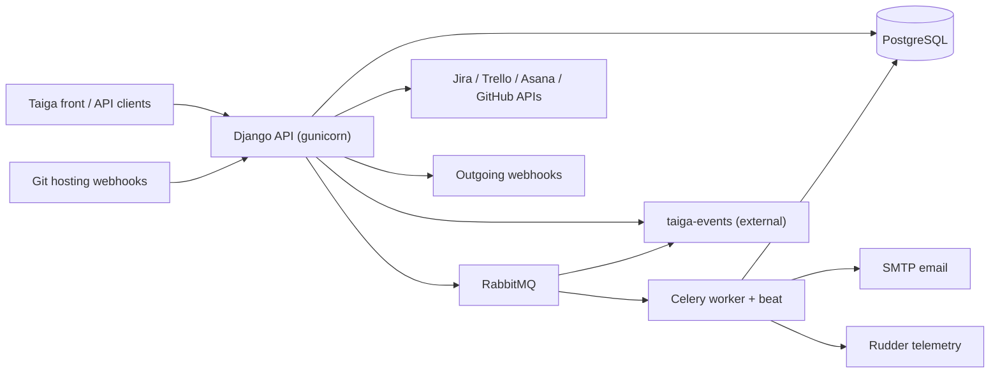

# Harness assessment: Taiga Backend (taiga-back)

Written by uw-harness 0.3.0 (spec v4) on 2026-11-01. It records what the repository showed before the harness was built. Do not edit it by hand: run `npx uw-harness analyze --force` to refresh it.

**Score before:** 23/100, level 0.

## The product

Django REST API backend of Taiga, an open-source agile project management platform (Scrum and Kanban).

Taiga lets agile teams plan and track work with backlogs, sprints, Kanban boards, epics, user stories, tasks, issues and wikis. This repository is the API server that stores all project data, enforces permissions, sends notifications and webhooks, and imports projects from other tools (Jira, Trello, Asana, GitHub). Self-hosters run it with Docker; the public SaaS is tree.taiga.io.

**Users:** Project members (developers, product owners, scrum masters) using the Taiga web front end through this API, Project administrators who configure roles, memberships, statuses and custom attributes, Instance administrators who self-host Taiga (Django admin, sample data, management commands), External systems: Git hosting webhooks (GitHub, GitLab, Bitbucket, Gogs) and webhook consumers, Front-end and third-party API clients (application tokens)

### Use cases

- **Authentication and accounts.** Login, registration, JWT refresh tokens, password recovery, invitation acceptance and user profile management. Entry points: `taiga/routers.py: /api/v1/auth -> taiga/auth/api.py AuthViewSet`, `/api/v1/users -> taiga/users/api.py UsersViewSet`, `taiga/auth/tokens.py`, `taiga/auth/token_denylist/`.
- **Project and membership management.** Create projects from templates (Scrum/Kanban), manage memberships, invitations, roles, statuses, points, swimlanes and due dates. Entry points: `/api/v1/projects -> taiga/projects/api.py ProjectViewSet`, `/api/v1/memberships, /api/v1/invitations`, `/api/v1/project-templates`, `taiga/projects/models.py`.
- **Backlog, sprints and Kanban.** Manage user stories, milestones (sprints), tasks, ordering in backlog and Kanban, epics and tags. Entry points: `taiga/projects/userstories/`, `taiga/projects/milestones/`, `taiga/projects/tasks/`, `taiga/projects/epics/`, `tests/integration/test_userstories_update_kanban_order.py`.
- **Issues, wiki and attachments.** Track issues with priorities/severities, write wiki pages with Markdown rendering, upload attachments. Entry points: `taiga/projects/issues/`, `taiga/projects/wiki/`, `taiga/projects/attachments/`, `taiga/mdrender/`.
- **Notifications, history and timeline.** Record change history of every object, notify watchers by email and web notifications, build user and project timelines. Entry points: `taiga/projects/history/`, `taiga/projects/notifications/`, `taiga/timeline/`, `/api/v1/web-notifications`, `/api/v1/notify-policies`.
- **Real-time events and webhooks.** Push change events to taiga-events (via PostgreSQL or RabbitMQ backend) and send outgoing webhooks to configured URLs. Entry points: `taiga/events/events.py`, `taiga/events/backends/rabbitmq.py`, `taiga/events/backends/postgresql.py`, `taiga/webhooks/`.
- **Git hosting integrations (incoming hooks).** Receive push/issue events from GitHub, GitLab, Bitbucket and Gogs to change status of stories, tasks and issues from commit messages. Entry points: `taiga/hooks/github/`, `taiga/hooks/gitlab/`, `taiga/hooks/bitbucket/`, `taiga/hooks/gogs/`.
- **Import and export.** Import projects from Jira, Trello, Asana, GitHub and Pivotal; export and import Taiga project dumps. Entry points: `taiga/importers/jira/`, `taiga/importers/trello/`, `taiga/importers/asana/`, `taiga/importers/github/`, `taiga/export_import/`.
- **Search, stats and telemetry.** Search inside a project, compute project/system stats, send daily anonymous telemetry via Rudder (Celery beat). Entry points: `taiga/searches/`, `taiga/stats/`, `taiga/telemetry/tasks.py`, `taiga/celery.py: beat_schedule send-telemetry-once-a-day`.
- **Local sample data.** Reset the database and load an initial admin user, project templates and generated sample data. Entry points: `regenerate.sh`, `taiga/projects/management/commands/sample_data.py`, `manage.py loaddata initial_user / initial_project_templates`.

### Glossary

| Term | Meaning |
| --- | --- |
| US / user story | Unit of backlog work (taiga/projects/userstories). |
| Milestone | A sprint in Scrum projects (taiga/projects/milestones). |
| Epic | Group of related user stories (taiga/projects/epics). |
| Swimlane | Horizontal lane on a Kanban board (/api/v1/swimlanes). |
| Points | Story-point estimation values per role. |
| Fan / watcher / vote / like | Ways a user follows or supports a project or item (taiga/projects/votes, likes, notifications). |
| OCC | Optimistic concurrency control on edits (taiga/projects/occ). |
| Timeline | Activity feed for users and projects (taiga/timeline). |
| Taiga events | Separate real-time service that receives pushes from taiga/events backends (not in this repository). |
| Contribs | Optional plugins (Slack, GitHub/GitLab auth, protected) installed from requirements-contribs.txt. |
| Kaleidos INC | Company that owns the Taiga copyright (license headers, CONTRIBUTING.md). |
| INSTANCE_TYPE | Setting naming the installation type, 'SRC' in settings/common.py (used by telemetry). |

## Stack

- Languages: Python 3.10 (.python-version, CI); Docker image uses Python 3.11, Shell
- Frameworks: Django 3.2.25 (requirements.txt), Taiga's own REST layer in taiga/base/api (DRF-like ViewSets and routers), Celery 5.5.3, gunicorn 23, django-jinja, pytest 7.2.1 + pytest-django + factory-boy 3.2.1
- Data stores: PostgreSQL (settings/common.py DATABASES, CI uses postgres:13), Django local-memory cache (settings/common.py CACHES), Local filesystem media (MEDIA_ROOT)
- External services: RabbitMQ as Celery broker and events push backend (docker/config.py, CI service), taiga-events real-time service (separate, not in repository), SMTP email (docker/config.py EMAIL_*), Rudder telemetry (taiga/telemetry/tasks.py), Jira, Trello, Asana, GitHub APIs (taiga/importers), GitHub, GitLab, Bitbucket, Gogs incoming webhooks (taiga/hooks), Coveralls (CI)

## Architecture

| Component | Kind | Path | Tech | What it does |
| --- | --- | --- | --- | --- |
| API web app | web/api | `taiga/ (taiga/urls.py, taiga/routers.py, taiga/wsgi.py)` | Django 3.2 + gunicorn | REST API under /api/v1/ with about 80 router registrations, plus Django admin at /admin/ and optional front sitemap. Started by docker/entrypoint.sh (migrate, loaddata, gunicorn on :8000). |
| Celery worker and beat | worker/scheduler | `taiga/celery.py, docker/async_entrypoint.sh` | Celery 5 with RabbitMQ broker | Runs async tasks (bulk emails, exports, imports, telemetry, token flush). Beat schedule is built in taiga/celery.py. Disabled in tests (CELERY_ENABLED=False). |
| Domain apps | library | `taiga/projects, taiga/users, taiga/auth, taiga/timeline, taiga/webhooks, taiga/hooks, taiga/importers, taiga/export_import, taiga/searches, taiga/stats` | Django apps | Models, services, serializers, validators, permissions and API viewsets per domain. |
| Base framework | library | `taiga/base` | Python | Own REST framework layer (api, routers, filters, throttling, exceptions), DB helpers, mail connectors, management commands. |
| Events push | integration | `taiga/events` | PostgreSQL NOTIFY or RabbitMQ backends | Publishes change events consumed by the separate taiga-events service. |
| Settings | config | `settings/ (common.py, config.py.dev.example, config.py.prod.example), docker/config.py, tests/config.py` | Django settings modules | common.py holds defaults; docker/config.py reads environment variables and is copied to settings/config.py in the image; tests/config.py is the pytest settings. |
| PostgreSQL | database | `settings/common.py DATABASES` | PostgreSQL 13 in CI | Main data store, also used for DB sessions and the postgresql events backend. |
| RabbitMQ | queue | `docker/config.py CELERY_BROKER_URL, EVENTS_PUSH_BACKEND_URL` | AMQP | Celery broker and events transport in the Docker deployment. |
| Docker image | build artifact | `docker/Dockerfile` | python:3.11-slim | Single image for API (entrypoint.sh) and async worker (async_entrypoint.sh). No compose file in this repository. |
| Tests | tests | `tests/ (unit, integration, integration/resources_permissions)` | pytest + pytest-django + factory-boy | About 120 test files; need a running PostgreSQL. |

## Workflows found in the repository

- setup: `./scripts/install`
- run local: not found
- test: `pytest`
- lint: `tox -e flake8`
- build: not found
- deploy: not found

## Requirements

### ✗ An AGENTS.md at the root

`agents-file`, level 1. Check: no AGENTS.md.

**Gap.** No agent entry file exists.

**Plan.** Create AGENTS.md (<150 lines) with what this is, commands (make setup, make dev, make check-fast, make check), layout (taiga/, settings/, tests/, docker/, scripts/), conventions (conventional commits, MPL header, flake8 max-line 120), verification, never-do list, links to docs/. Create CLAUDE.md containing only `@AGENTS.md`.

Reference: https://docs.unwritten.sh/harness/requirements/agents-file/

### ✗ AGENTS.md matches the repository

`agents-file-accurate`, level 1. Check: no AGENTS.md to check.

**Gap.** Nothing to verify yet.

**Plan.** Only reference Makefile targets created in the same change and relative links to docs that are created (docs/architecture.md, docs/product.md, docs/local-dev.md, docs/deploy.md, docs/observability.md).

Reference: https://docs.unwritten.sh/harness/requirements/agents-file-accurate/

### ✗ An architecture overview with a diagram

`architecture`, level 1. Check: no docs/architecture.md.

**Gap.** No architecture document.

**Plan.** Create docs/architecture.md with the Mermaid flowchart (API, Celery, PostgreSQL, RabbitMQ, taiga-events, SMTP, importers, hooks), a section per component with folders (taiga/routers.py, taiga/celery.py, taiga/events/backends, settings/, docker/), and state that taiga-events and the front end live in other repositories.

Reference: https://docs.unwritten.sh/harness/requirements/architecture/

### ◐ What the product does and for whom

`product`, level 1. Check: only README.md (47 lines), no docs/product.md.

**Gap.** No docs/product.md describing value, users and use cases tied to code.

**Plan.** Create docs/product.md with value proposition, roles, the use cases with entry points (routers.py prefixes, app folders, regenerate.sh) and the glossary (user story, milestone, epic, swimlane, OCC, timeline, contribs).

Reference: https://docs.unwritten.sh/harness/requirements/product/

### ✗ Architecture decision records

`decisions`, level 2. Check: no docs/decisions/.

**Gap.** No decision records.

**Plan.** Create docs/decisions/0001-record-architecture-decisions.md and 0002 for an inferred decision, for example Celery with RabbitMQ and pickle serializer, or pluggable events backends (taiga/events/backends), marked 'Inferred from the code, to be confirmed by the team.'

Reference: https://docs.unwritten.sh/harness/requirements/decisions/

### ◐ An implementation log

`implementation-log`, level 2. Check: only CHANGELOG.md.

**Gap.** No harness implementation log.

**Plan.** Create docs/harness/log.md with a first dated entry (2026-11-01) and tell agents in AGENTS.md to append one entry per significant change.

Reference: https://docs.unwritten.sh/harness/requirements/implementation-log/

### ✓ Team agreements

`agreements`, level 1. Check: CONTRIBUTING.md exists.

### ✗ One entry point for tasks

`task-runner`, level 1. Check: no Makefile, justfile, Taskfile or package.json scripts.

**Gap.** No single task entry point.

**Plan.** Add a Makefile with help (default), setup (wrap ./scripts/install), dev (.venv/bin/python manage.py runserver), db-reset (./regenerate.sh -y), test (.venv/bin/pytest), lint (.venv/bin/flake8 .; add flake8 to dev deps or use tox -e flake8), check-fast, check, each with a ## comment.

Reference: https://docs.unwritten.sh/harness/requirements/task-runner/

### ✗ A fast gate

`fast-gate`, level 2. Check: no fast gate target (for example check-fast).

**Gap.** No fast gate; tests need PostgreSQL (tests/config.py DATABASES localhost taiga/taiga).

**Plan.** Add `check-fast`: flake8 plus `pytest tests/unit -q`. Verify which unit tests need the DB (pytest-django marks); the target must work after `make setup` with the compose PostgreSQL running. Skip existing failing tests with a reason and record them in docs/harness/log.md.

Reference: https://docs.unwritten.sh/harness/requirements/fast-gate/

### ✗ A full gate

`full-gate`, level 2. Check: no full gate target (for example check).

**Gap.** No full gate matching CI.

**Plan.** Add `check`: lint + `python manage.py makemigrations --check --dry-run` (settings tests.config) + full pytest with the same coverage command as CI. Make CI call `make check`.

Reference: https://docs.unwritten.sh/harness/requirements/full-gate/

### ✓ Automated tests

`tests`, level 1. Check: 120 test files (ignored: 11 without any test, 1 with only trivial assertions).

### ◐ CI runs the gate on every change

`ci`, level 2. Check: .github/workflows/tests-and-coverall.yml exist but do not call the task runner.

**Gap.** CI does not call the task runner and does not run flake8.

**Plan.** Change the test step to `make check` (keep coverage and Coveralls), add a job step running `npx -y uw-harness verify` with Node 20. Keep the postgres and rabbitmq services and the GITHUB_WORKFLOW DB switch in tests/config.py.

Reference: https://docs.unwritten.sh/harness/requirements/ci/

### ✗ Git hooks run the fast gate

`hooks`, level 3. Check: no git hooks configuration.

**Gap.** No git hooks.

**Plan.** Add .pre-commit-config.yaml with a flake8 hook and a pre-push local hook running `make check-fast`; install it from `make setup` (pre-commit install --hook-type pre-push). Add pre-commit to requirements-devel.in.

Reference: https://docs.unwritten.sh/harness/requirements/hooks/

### ✗ The app runs locally with one command

`local-env`, level 1. Check: no compose file, devcontainer or dev target.

**Gap.** Data stores must be installed by hand and there is no dev target.

**Plan.** Add compose.yaml with postgres:13 (user/pass/db taiga as in settings/common.py and tests/config.py) and rabbitmq; Makefile `dev` (copy settings/config.py.dev.example to settings/config.py if missing, runserver) and `db-reset` (./regenerate.sh -y with defaults). Write docs/local-dev.md (prerequisites: Python 3.10, libpq, libmagic, gettext; first run; reset; debugging; admin/123123 sample user).

Reference: https://docs.unwritten.sh/harness/requirements/local-env/

### ✗ Configuration is documented, no secret in git

`env-example`, level 1. Check: no .env.example.

**Gap.** No example env file, and the default settings contain a hard-coded SECRET_KEY and passwords that the secret scan will flag even after .env.example exists.

**Plan.** Create .env.example listing every os.getenv variable of docker/config.py (POSTGRES_*, TAIGA_SECRET_KEY, TAIGA_SITES_*, RABBITMQ_*, CELERY_*, EMAIL_*, ENABLE_* importers/contribs, WEBHOOKS_*, ENABLE_TELEMETRY) with safe empty values. Report the hard-coded SECRET_KEY in settings/common.py to a human; do not change settings behaviour silently.

Reference: https://docs.unwritten.sh/harness/requirements/env-example/

### ✓ Toolchain versions are pinned

`toolchain-pinned`, level 1. Check: .python-version exists.

### ◐ Deployment is explicit in the repository

`deploy-explicit`, level 3. Check: deployment artifacts (docker/Dockerfile) but no docs/deploy.md.

**Gap.** No deploy document; how images are built, published and deployed (tree.taiga.io, Docker Hub) is not visible in the repository.

**Plan.** Create docs/deploy.md with what the repo shows (image build, entrypoints, env vars from docker/config.py, migrations on start) and uw-harness TODO blocks for registry, environments, release process, rollback and who deploys.

Reference: https://docs.unwritten.sh/harness/requirements/deploy-explicit/

### ✗ Production can be observed

`observability`, level 3. Check: no docs/observability.md.

**Gap.** No observability document; no health endpoint or error reporting is configured in the code.

**Plan.** Create docs/observability.md: logging config (settings/common.py LOGGING, stdout in Docker), gunicorn access logs, Celery logs, no health endpoint (suggest /api/v1/ answer as liveness), sentry-sdk installed but unused, plus TODO blocks for where logs, dashboards and alerts live.

Reference: https://docs.unwritten.sh/harness/requirements/observability/

### ✗ Skills for repeated tasks

`skills`, level 2. Check: no skills in .agents/skills/ or .claude/skills/.

**Gap.** No skills.

**Plan.** Create .agents/skills/implement-change, debug-local (compose DB, regenerate.sh, runserver, pytest -k, pdb), add-api-endpoint (viewset in app api.py + register in taiga/routers.py + permissions + integration test in tests/integration/resources_permissions), and deploy as a pointer to docs/deploy.md TODOs. Symlink .claude/skills -> .agents/skills.

Reference: https://docs.unwritten.sh/harness/requirements/skills/

## Questions for a human

- (`deploy-explicit`) How does a merged change reach production (tree.taiga.io and the public taiga-back Docker image): who builds and pushes the image, to which registry, and from which repository or pipeline? No deploy workflow or registry is visible; docker/Dockerfile is the only artifact.
- (`deploy-explicit`) Which environments exist (staging, production, on-premise customers) and how is a release rolled back, given that docker/entrypoint.sh runs migrations on start? Rollback with automatic migrations needs a human-defined procedure.
- (`observability`) Where are production logs, metrics and alerts for the API and Celery workers, and is Sentry (sentry-sdk is a dependency) configured somewhere outside this repository? The code has no Sentry init and no health endpoint; log location is not visible.
- (`observability`) What is the signal that production is broken (health check URL, key metric, alert channel)? Needed for the 'how to tell something is wrong' section.
- (`agreements`) What is the team's definition of done and review rule (number of approvals, who can merge to main, squash or merge commits)? History shows merge commits from PRs and conventional commits, but no written review rule.
- (`env-example`) Is the SECRET_KEY hard-coded in settings/common.py used by any real installation, and should it be replaced by an environment variable? It is a secret-looking value in tracked code; only the team can decide on rotation and change.
- (`local-env`) Which local setup do developers actually use today (local PostgreSQL, the taiga-docker repository, or something else), and should the new compose.yaml include RabbitMQ and taiga-events? The repository shows no compose file; the dev flow is not documented.

## Risks

- Tests need a running PostgreSQL (tests/config.py: localhost, user/pass taiga; or postgres/postgres when GITHUB_WORKFLOW is set). The fast gate will fail without the database.
- Hard-coded SECRET_KEY in settings/common.py line 249 and default DB/email passwords: the env-example secret scan will report partial until a human decides.
- Django 3.2.25 is end-of-life; several pins exist only to stay compatible (bleach<5, django-picklefield<3.3, easy-thumbnails<2.9). Upgrades can break installation.
- Python mismatch: .python-version and CI use 3.10, Docker image uses 3.11.
- System libraries needed to install requirements (libpq-dev for psycopg2, libmagic for python-magic, cairo for cairosvg, gettext for compilemessages) are not documented.
- flake8 is not in requirements-devel.txt; lint only runs through tox (tox -e flake8), and CI does not lint at all, so the current code may not pass flake8.
- requirements-contribs.txt installs plugins from GitHub over the network; it must stay out of the gates.
- Celery uses pickle serialization (settings/common.py, docker/config.py); a security-sensitive decision to document, not change.
- sentry-sdk and rudder-sdk-python (pre-release 1.0.0b1) are dependencies; sentry is not initialised in code, which may mislead the observability doc.
- regenerate.sh drops the database and is interactive; never run it in a gate without -y and a local DB.
- 11 test files contain no tests (stubs such as tests/models.py); do not count them as coverage.
